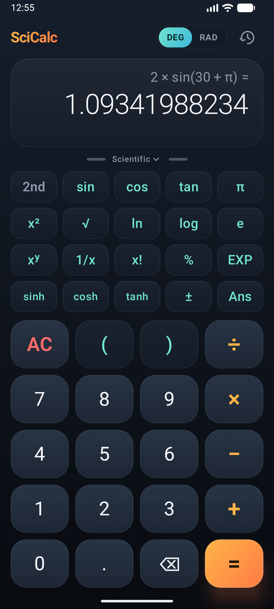
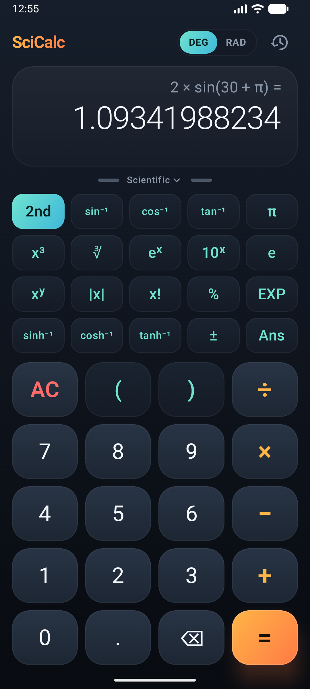

# SciCalc

A scientific calculator for Android, built with Kotlin and Jetpack Compose. It has a dark theme, a live result preview, and a collapsible scientific keypad.

<p align="center">
  
  &nbsp;&nbsp;
  
</p>

## Features

- **Live preview.** The answer appears as you type, before you press `=`.
- **Scientific functions:**
  - sin, cos, tan and their inverses; sinh, cosh, tanh and their inverses
  - ln, log, eˣ, 10ˣ, x², x³, √, ∛, xʸ, 1/x, |x|
  - x! (factorials of decimals work too), %, EXP, π, e, Ans
- **Natural input.** You can write `2π` or `3(4)` without a × sign. Missing closing brackets are filled in for you and shown faded. The usual order of operations applies (`−2² = −4`).
- **DEG / RAD switch**, remembered between sessions.
- **History.** Tap a past result to reuse it. History is kept between sessions.
- **Shortcuts:**
  - Swipe the display to delete the last character.
  - Long-press the display to copy the result.
  - Long-press ⌫ to clear everything.
  - Tap or swipe the "Scientific" bar to hide or show the scientific keys.
- **Clear errors.** The display shakes and shows a plain message, such as "Can't divide by 0".
- **Feel.** Keys bounce and vibrate slightly when tapped, and a landscape layout shows every key at once.
- **Screen readers.** Every key is labelled.

## Install

Download `SciCalc.apk` from the [latest release](../../releases/latest) and open it on your phone. You may need to allow installs from your browser or file manager. Requires Android 8.0 or newer.

## Build from source

Requirements: JDK 17 or newer and the Android SDK (platform 36). Android Studio provides both.

```bash
./gradlew assembleRelease        # APK → app/build/outputs/apk/release/
./gradlew testDebugUnitTest      # calculator engine tests
```

## Project layout

| File | Purpose |
|---|---|
| `app/src/main/java/com/example/scicalc/CalcEngine.kt` | Recursive-descent expression parser, math functions, number formatting |
| `app/src/main/java/com/example/scicalc/CalculatorViewModel.kt` | Input rules, history, saved settings |
| `app/src/main/java/com/example/scicalc/ui/CalculatorScreen.kt` | Display, keypads, history sheet, gestures |
| `app/src/main/java/com/example/scicalc/ui/Keys.kt` | Animated key component |
| `app/src/test/.../CalcEngineTest.kt` | Engine unit tests |
